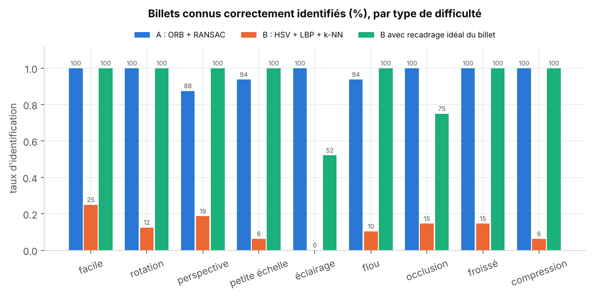

# Reconnaissance de billets de banque par ORB + RANSAC

Reconnaissance de la coupure d'un billet de banque (francs congolais) sur une photo prise librement, avec des méthodes classiques de reconnaissance des formes, sans apprentissage profond.
Projet du cours de Reconnaissance des formes, Master 1 Intelligence artificielle et sciences des données, Université de Kinshasa (sujet 39, variante A).

**Méthode (variante A)** : points d'intérêt et descripteurs ORB, appariement par distance de Hamming avec le test de ratio de Lowe, estimation d'une homographie par RANSAC par rapport à **une seule image de référence** par billet et par face. Le nombre d'inliers sert de score. En dessous d'un seuil τ, la photo est rejetée (« inconnu »), et l'homographie localise le billet dans la photo.

**Comparaison (variante B)** : histogrammes de couleur HSV + textures LBP + k plus proches voisins, sur les mêmes données.

## Résultats (680 photos de test)

| | A : ORB + RANSAC | B : HSV + LBP + k-NN | B, billet recadré (oracle) |
|---|---|---|---|
| F1 macro (12 billets connus) | **0,966** | 0,121 | 0,814 |
| Billets connus bien identifiés | **97,2 %** | 12,0 % | 91,9 % |
| Confusions entre coupures | **0,2 %** | 53,5 % | 6,2 % |
| Billets inconnus acceptés à tort | 7,3 % | 55,6 % | 49,6 % |
| Localisation (IoU moyen) | 0,973 | – | – |
| Temps par photo (1 processus) | 255 ms | 36 ms | – |

- Presque toutes les fausses acceptations de A viennent de billets inconnus **de même maquette** qu'un billet connu : 23,6 % de fausses acceptations sur ces billets, contre 0,6 % sur tous les autres.
- Relancer sur la photo agrandie ×2 les photos rejetées corrige la faiblesse d'ORB sur les billets photographiés de loin : le F1 de validation passe de 0,958 à 0,990.
- B dépend du cadrage : sur une photo libre, le fond domine son histogramme.



## Données

Aucune base publique de billets en francs congolais n'existe. La méthode est mise au point et mesurée sur 44 billets historiques numérisés (collection de David St-Onge, projet [Hyperinflation Archive](https://github.com/Rogzy-DB/hyperinflation-bank-note)), utilisés comme substitut. Ces images ne sont pas couvertes par la licence de ce dépôt et n'y sont pas copiées : `code/telecharger_billets.py` les récupère à la version exacte utilisée.

Un générateur (`code/billets/synthese.py`) produit des photos réalistes à vérité terrain exacte, réparties en neuf types de difficulté : facile, rotation, perspective, petite échelle, éclairage, flou, occlusion par la main, billet froissé, compression. Il produit 336 photos de validation, 680 de test et 858 d'apprentissage pour B, avec 22 billets inconnus jamais vus dans le test.

Pour de vraies photos de francs congolais, voir `donnees/photos/LISEZMOI.md` et `code/preparer_photos_reelles.py`.

## Reproduire

```bash
pip install -r requirements.txt
cd code
python telecharger_billets.py            # 44 images de billets (9 Mo)
python construire_jeux.py                # jeux de validation, test et apprentissage B (~5 min)
python experiences.py                    # ablation, réglage des seuils, test final
python experience_b_recadree.py          # variante B avec recadrage idéal
python figures.py                        # figures
python demo.py --refs ../donnees/billets_publics --appariements photo.jpg
```

Le notebook `Reconnaissance_billets_ORB_RANSAC.ipynb` (déjà exécuté, compatible Google Colab) suit la chaîne pas à pas sur une photo, puis présente les résultats.

## Organisation

| Chemin | Contenu |
|---|---|
| `code/billets/methode_orb.py` | Variante A : `ReconnaisseurORB` (références, appariement, RANSAC, contrôle géométrique, rejet, relance zoom) |
| `code/billets/methode_hist.py` | Variante B : descripteurs HSV + LBP, k-NN |
| `code/billets/synthese.py` | Générateur de photos |
| `code/billets/evaluation.py` | Métriques en monde ouvert, IoU, matrices de confusion |
| `code/billets/pretraitement.py` | Niveaux de gris + CLAHE, recadrage automatique d'une photo de référence |
| `resultats/` | Résultats chiffrés (CSV, JSON) |
| `figures/` | Figures |

## Licence

Code sous licence MIT (voir `LICENSE`). Les images de billets restent la propriété de leurs ayants droit (voir la section Données).
